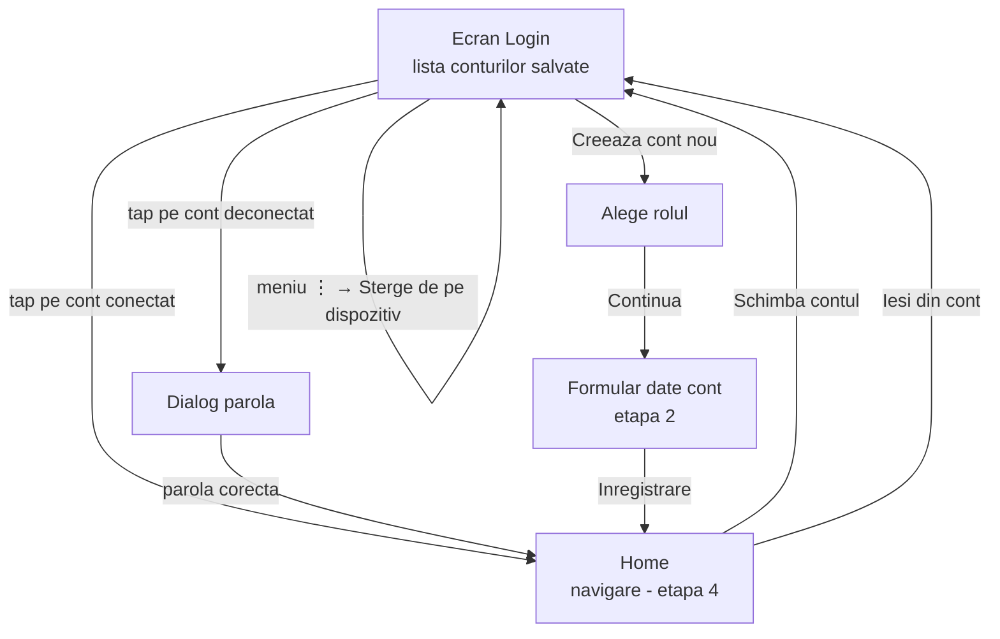

# Planul aplicatiei

## Fluxul ecranelor

## Starile unui cont salvat pe dispozitiv

Ca la Google / Facebook, un cont salvat poate fi in una din 3 situatii:

| Stare | Ce vede utilizatorul | Ce se intampla la tap |
|---|---|---|
| **Conectat** | Contul in lista, eticheta „Conectat” | Intra direct in aplicatie |
| **Deconectat** | Contul in lista, eticheta „Necesita parola” | Cere parola |
| **Sters** | Contul nu mai apare | — trebuie adaugat din nou |

## Etape

| Etapa | Ce facem | Document |
|---|---|---|
| 1 | Ecranul de login cu conturi salvate (date de test, in memorie), navigare spre alegerea rolului si un Home provizoriu | [01-ecran-login.md](01-ecran-login.md) |
| 2 | Formularul de inregistrare dupa alegerea rolului; contul nou apare in lista | — |
| 3 | Conturile salvate raman si dupa ce inchizi aplicatia (stocare pe dispozitiv) | — |
| 4 | Interfata de navigare dupa logare (diferita pe rol) | — |

Fiecare etapa = cel putin un commit.
